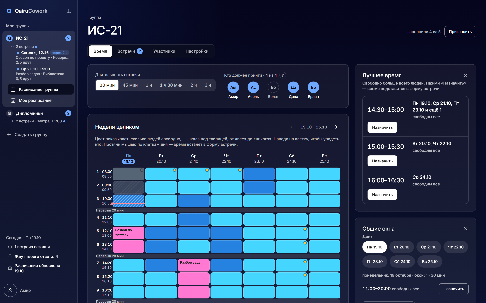
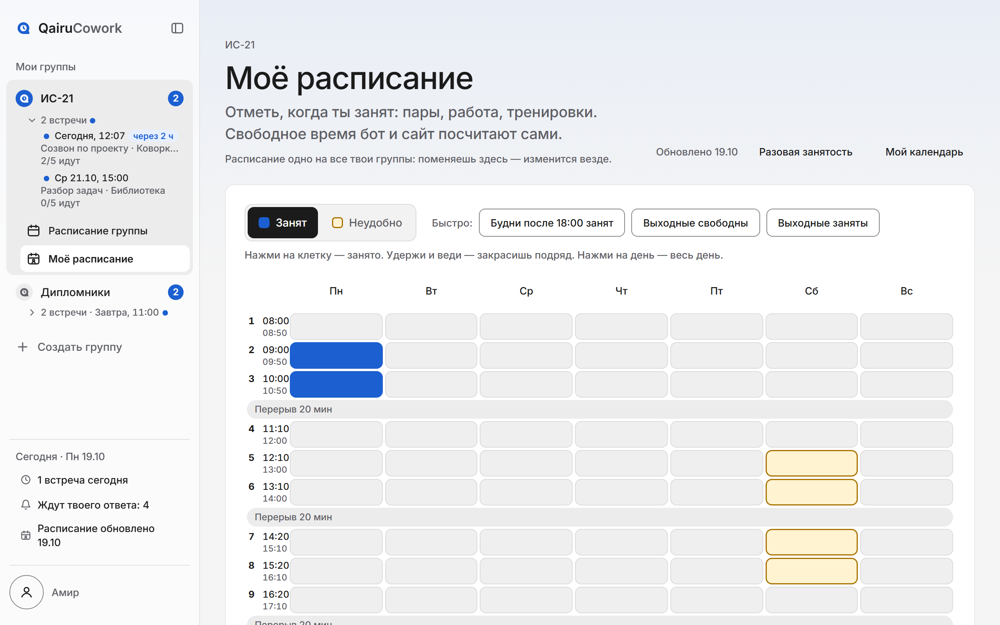
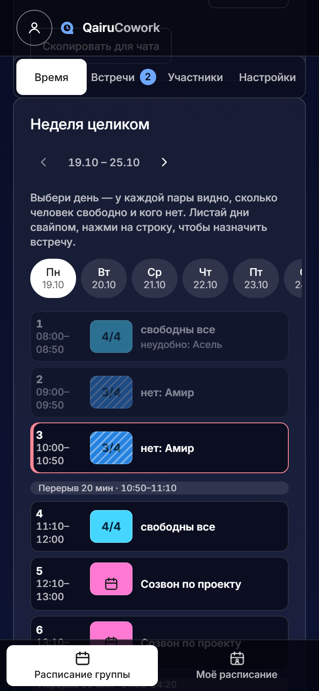
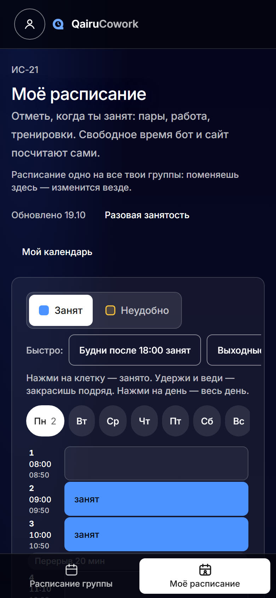
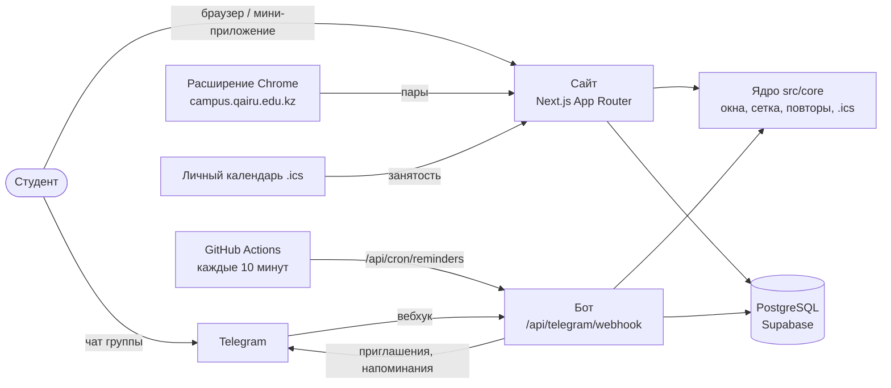

<a id="top"></a>

<div align="center">


# QairuCowork

**Общие свободные окна для студенческой группы и встреча в два касания.**<br>
Каждый один раз отмечает свои пары, а сайт и Telegram-бот сами находят, когда свободны все.

[**Открыть сайт**](https://qairu-cowork.vercel.app) ·
[**Бот @QairuCoworkbot**](https://t.me/QairuCoworkbot) ·
[Расширение для кампуса](https://qairu-cowork.vercel.app/extension) ·
[Деплой](DEPLOY.md) ·
[Архитектура](DESIGN.md)

[](https://github.com/wypas0/qairu-cowork/actions/workflows/ci.yml)
[](https://github.com/wypas0/qairu-cowork/actions/workflows/smoke.yml)


</div>

---

## Содержание

- [Зачем это](#зачем-это)
- [Возможности](#возможности)
- [Как начать](#как-начать)
- [Как это выглядит](#как-это-выглядит)
- [Как внести расписание](#как-внести-расписание)
- [Команды бота](#команды-бота)
- [Страницы сайта](#страницы-сайта)
- [Как это устроено](#как-это-устроено)
- [Собрать и запустить](#собрать-и-запустить)
- [Частые вопросы](#частые-вопросы)
- [Документация](#документация)

## Зачем это

Договориться о встрече в группе из двадцати человек — это полчаса переписки «а мне в 15:00 не могу».
QairuCowork убирает эту переписку: каждый **один раз** отмечает, когда занят (пары, работа, тренировки),
и дальше карта недели показывает, когда свободны все или почти все. Назначил время — бот разослал
приглашения, собрал ответы и напомнил перед началом.

Сайт и бот — **два лица одного продукта**: одна база, одно ядро расчёта, один вход через Telegram.
Расписание принадлежит человеку, а не чату: одно на все его группы — поправил в одной, изменилось везде.

## Возможности

- **Карта недели** — цвет каждой пары показывает, сколько человек свободно. Наведи на имя — видно,
  когда свободен этот человек; протяни мышью по клеткам дня — время встанет в форму встречи.
- **Лучшее время и общие окна** — готовые варианты с кнопками «Назначить» и «Скопировать для чата».
  Можно выбрать длительность, убрать тех, без кого можно обойтись, и задать кворум («свободны 80%»).
- **«Занят» и «неудобно»** — «неудобно» значит «могу, но лучше не надо»: такие окна предлагаются последними.
- **Числитель и знаменатель** — пары «через неделю» считаются от даты начала семестра.
- **Личный календарь** — подключи свой `.ics` по ссылке, и занятость подтянется сама.
- **Расширение для кампуса** — переносит пары с campus.qairu.edu.kz одной кнопкой.
- **Встречи** — приглашения с ответами кнопками, напоминания, итоги, «Повторить» и выгрузка в календарь.
- **Друзья** — добавляй по нику в Telegram, своей ссылке или QR, прямо из «Участников». Видно группы
  друга (каждую свою можно скрыть) и когда вы оба свободны; позвать друга в группу или попроситься в
  его — в одно нажатие, а без согласия второй стороны в группу никто не попадает. Есть блокировка.
- **Встреча вдвоём** — на карточке друга время выбирается кнопками по общим окнам (длина, день,
  начало), и другу в Telegram приходит такая же карточка с ответами, как у встреч группы; бот
  напомнит обоим перед началом.
- **«Как это работает»** — над каждым разделом свёрнутая подсказка в несколько шагов.
- **Бот в чате группы** — `/free` показывает общие окна, `/meeting` назначает встречу с опросом;
  бот предупреждает, если встреча легла на чьё-то занятое время.
- **Телефон и Telegram** — на телефоне один день крупными строками, дни листаются свайпом; внутри
  Telegram сайт открывается как мини-приложение без входа.
- **Клавиатура** — по карте и по сетке расписания можно ходить стрелками.
- **Три языка** — русский, қазақша, english.

<p align="right"><a href="#top">↑ наверх</a></p>

## Как начать

1. Открой [@QairuCoworkbot](https://t.me/QairuCoworkbot) и нажми `/start` — сайт откроется прямо
   в Telegram, входить не нужно. В обычном браузере — [qairu-cowork.vercel.app](https://qairu-cowork.vercel.app),
   кнопка «Войти через Telegram» и подтверждение в боте.
2. Староста нажимает «Создать группу» и зовёт одногруппников ссылкой или QR-кодом. Можно и из чата:
   добавить бота в чат группы и написать `/setup`.
3. Каждый один раз отмечает свою занятость в «Моём расписании»: переносит пары из кампуса расширением
   или закрашивает клетки.
4. Карта недели показывает, когда свободны все. «Назначить» — и бот разошлёт приглашения, соберёт
   ответы и напомнит перед встречей.

## Как это выглядит

**Карта недели**, лучшее время и общие окна:



**Моё расписание**: кисти «Занят» и «Неудобно», быстрые шаблоны, разовая занятость и личный календарь:



| Неделя на телефоне | Своё расписание на телефоне |
|:---:|:---:|
|  |  |

<sub>Скриншоты сняты с демо-базы (`scripts/dev/e2e-server.mjs`), все имена выдуманы.</sub>

## Как внести расписание

Пустое «Моё расписание» начинается с выбора из двух путей:

- **Расширение для кампуса** — страница [`/extension`](https://qairu-cowork.vercel.app/extension):
  установка по шагам, обновление, частые проблемы, приватность. Расширение читает пары с
  campus.qairu.edu.kz и показывает их на сетке для проверки; сохраняются они только по кнопке «Сохранить».
  Если оно стоит, вверху редактора есть кнопка «Перенести из кампуса»: сайт открывает кампус,
  расширение предлагает перенос карточкой в углу и возвращает обратно.
- **Сетка** — закрасить пары клетками мышью или пальцем; кисть «Неудобно» — для времени, которое
  лучше не занимать.

> [!IMPORTANT]
> Чтобы заработала чётность недель, староста задаёт «Начало семестра» в настройках группы. Без этой
> даты пары «через неделю» **не учитываются** — сайт не угадывает, какая неделя сейчас.

Экзамены, сессии и поездки — «Разовая занятость» там же: дата, период или «весь день».

<p align="right"><a href="#top">↑ наверх</a></p>

## Команды бота

Бот прежде всего присылает уведомления: напомнить заполнить расписание, приглашения на встречи
(отвечать можно прямо кнопками), ответы участников, напоминание перед началом. Расписание, разовая
занятость и настройки группы — на сайте; старые команды (`/schedule`, `/busy`, `/settings` и другие)
отвечают кнопкой туда.

<details>
<summary><b>В личке</b></summary>

| Команда | Что делает |
|---|---|
| `/start` | открыть сайт |
| `/friends` | друзья: заявки, приглашения в группы, своя ссылка |
| `/lang` | язык |
| `/help` | справка |
| код группы | прислать боту — добавит в группу |

</details>

<details open>
<summary><b>В группе</b></summary>

| Команда | Что делает |
|---|---|
| `/setup` | подключить чат (админ) |
| `/join` | добавить себя в участники |
| `/members` | кто заполнил расписание, кто нет |
| `/free` | общие окна всех участников на неделю |
| `/free @asel @nurbek` | окна только с этими людьми |
| `/free 90` | окна не короче 90 минут |
| `/free 80%` · `q5` | кворум: свободны 80% участников / хотя бы 5 человек |
| `/meeting` | назначить встречу с опросом, напоминанием и выгрузкой в календарь |
| `/remind` | напомнить незаполнившим одним сообщением (админ) |
| `/link` | открыть группу на сайте |
| `/lang` | язык бота в чате (админ) |

</details>

## Страницы сайта

<details>
<summary><b>Все адреса</b></summary>

| Адрес | Что там |
|---|---|
| `/` | витрина продукта; у вошедшего — группы, вход по коду и «Создать группу» в сайдбаре (на компьютере полоса слева, раскрывается наведением; на телефоне кнопка «Мои группы») |
| `/g/{slug}` | карта недели, лучшее время, общие окна, встречи, участники, настройки |
| `/g/{slug}/me` | своя сетка («занят» и «неудобно»), перенос из кампуса, разовая занятость, личный календарь |
| `/g/{slug}/join` | вход по ссылке-приглашению |
| `/g/{slug}/qr` | QR-код приглашения на весь экран — для проектора в аудитории |
| `/g/{slug}/meetings/{id}.ics` | встреча файлом для календаря |
| `/extension` | расширение Chrome для кампуса: установка, обновление, проверка «установлено, версия …» |
| `/friends` | друзья, заявки и приглашения в группы, поиск по нику и своя ссылка, приватность |
| `/friends/{id}` | карточка друга: встреча вдвоём (выбор по общим окнам), ваши встречи, его группы, позвать в группу |
| `/f/{код}` | чужая личная ссылка «добавь меня в друзья» |
| `/admin` | консоль владельца (для остальных — 404), см. [DEPLOY.md](DEPLOY.md#шаг-8-по-желанию-консоль-владельца-admin) |

</details>

**Паролей нет — вход только через Telegram.** Внутри Telegram сайт узнаёт человека по подписанному
`initData`; в браузере — кнопка «Войти через Telegram» и подтверждение в боте. Поэтому пользователь
сайта и пользователь бота — один и тот же человек.

<p align="right"><a href="#top">↑ наверх</a></p>

## Как это устроено



Сайт и бот живут в одном Next.js-проекте и делят ядро расчёта (`src/core/` — чистые функции без
базы и сети) и базу. Почему так, как устроены модель данных и алгоритм поиска окон — в [DESIGN.md](DESIGN.md).

| Слой | Что используется |
|---|---|
| Сайт и API | Next.js 16 (App Router, server actions), React 19, TypeScript |
| База | PostgreSQL в Supabase, Drizzle ORM + `postgres`, миграции в `drizzle/` |
| Бот | Telegram Bot API через вебхук — маршрут того же Next.js-проекта |
| Хостинг | Vercel; cron напоминаний — GitHub Actions |
| Тесты | Vitest (ядро и логика), Playwright (сквозные, в том числе телефон и масштаб 67–200%) |
| Стили | свой CSS по разделам в `src/styles/`; от Tailwind — только сброс стилей |

<details>
<summary><b>Где что лежит</b></summary>

| Путь | Что там |
|---|---|
| `src/core/` | ядро: интервалы, окна, сетка, повторы, `.ics`, QR |
| `src/db/` | схема, клиент, запросы по темам в `queries/` |
| `src/bot/` | бот: `router.ts`, `handlers/` |
| `src/app/` | страницы и API-маршруты |
| `src/components/` | интерфейс; `board/` — доска группы |
| `src/i18n/` | строки: `ru.ts` — эталон, `kk.ts` и `en.ts` с теми же ключами |
| `drizzle/` | миграции базы |
| `scripts/` | проверка схемы, вебхук, проверка прода после деплоя, нагрузочный тест, локальная база |
| `tests/`, `e2e/` | модульные и сквозные тесты |

</details>

## Собрать и запустить

Нужен Node.js 22+. Посмотреть сайт у себя без Supabase и Telegram:

```bash
npm install
npx next build
node scripts/dev/e2e-server.mjs 3200
```

Скрипт поднимает Postgres в памяти (PGlite), заводит демо-группу «ИС-21» с пятью участниками и
встречами и запускает сайт на <http://127.0.0.1:3200>. Войти: в консоли браузера выполнить
`document.cookie = "qairu_token=<токен из терминала>; path=/"` и открыть `/g/smoke001`.

Проверки — те же, что гоняет CI на каждый пуш:

```bash
npm run typecheck && npm run lint && npm test && npm run e2e
```

> [!NOTE]
> Для локальной сборки используй `npx next build`: `npm run build` дополнительно сверяет схему базы
> и регистрирует вебхук бота из `BOT_TOKEN`.

Свой экземпляр с базой в Supabase, сайтом на Vercel и ботом — пошагово в **[DEPLOY.md](DEPLOY.md)**:
переменные окружения, миграции, cron, мониторинг и что делать, если что-то сломалось.

<p align="right"><a href="#top">↑ наверх</a></p>

## Частые вопросы

<details>
<summary><b>У меня нет Telegram. Можно без него?</b></summary>

Нет: вход только через Telegram, паролей нет. Зато ничего не нужно запоминать, а приглашения и
напоминания приходят туда же, где и так общается группа.
</details>

<details>
<summary><b>Видят ли одногруппники, чем я занят?</b></summary>

Группа видит только, свободен человек в каждую пару или нет, и отметку «неудобно».
Названия пар и причины занятости видны лишь тебе самому, в «Моём расписании».
</details>

<details>
<summary><b>Я в нескольких группах. Заполнять расписание в каждой?</b></summary>

Нет. Расписание одно на человека и общее для всех его групп.
</details>

<details>
<summary><b>Почему пары «через неделю» не учитываются?</b></summary>

Староста не задал «Начало семестра» в настройках группы. Без этой даты сайт не знает, какая
сейчас неделя — числитель или знаменатель.
</details>

<details>
<summary><b>Как добавить экзамен или поездку?</b></summary>

«Моё расписание» → «Разовая занятость»: конкретная дата, период или весь день.
</details>

## Документация

| Файл | О чём |
|---|---|
| [DESIGN.md](DESIGN.md) | цель, ограничения Telegram, модель данных, алгоритм окон, сценарии, риски |
| [DEPLOY.md](DEPLOY.md) | деплой по шагам, переменные окружения, cron, мониторинг, частые поломки |
| [scripts/load/README.md](scripts/load/README.md) | нагрузочный тест бота и сайта (`npm run load`) |

<p align="right"><a href="#top">↑ наверх</a></p>
